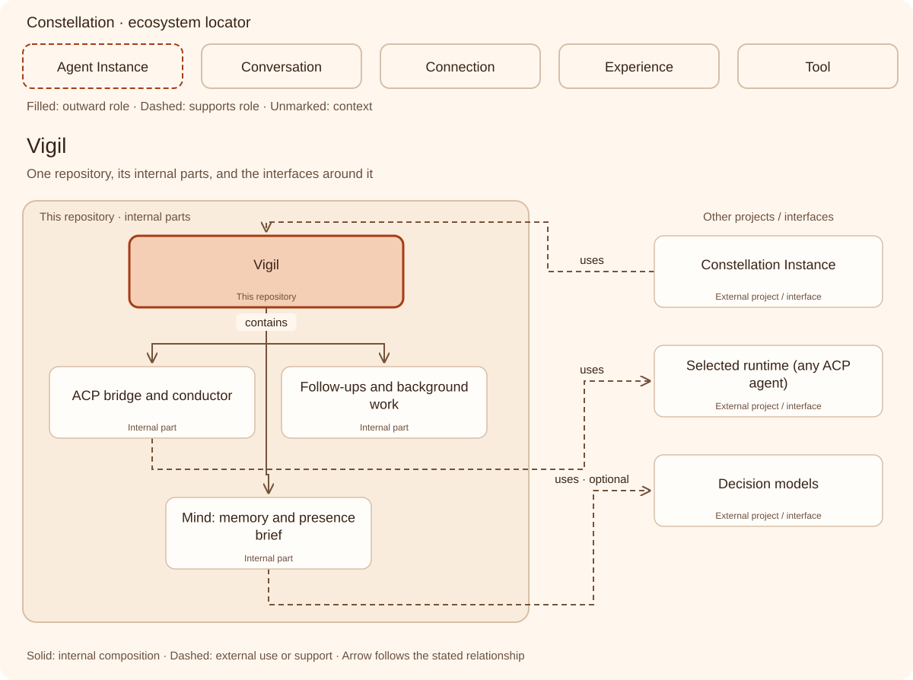

# Vigil

Vigil is an always-on mind for an [Amplifier Constellation](https://github.com/microsoft/amplifier-constellation) Agent Instance.

A Constellation agent already has a dependable outward identity: one Instance that Slack, Minecraft, Companion, Conversations and Observatory all attach to. Inside, each conversation is a separate session, and the engine wakes only when a message arrives. Vigil is an engine that stays awake between those messages. It gives the agent one memory across every place, a sense of who it is talking to and who else can hear, promises that survive the end of a session, and background work of its own.

To the Instance, Vigil is an ordinary ACP agent. Nothing in any experience changes.

The [product page](https://bkrabach.github.io/amplifier-constellation-vigil/) introduces it in a few minutes, with a map of where it fits.

Vigil is an independent open-source project. It works with the Constellation components but is not one of them; it is maintained in this repository.

```
Slack · Minecraft · Companion · Conversations · Observatory · any ACP client
                         │  ACP (unchanged)
                 Agent Instance            identity, tokens, attention, context sources
                         │  backend command:  vigil acp      (a thin bridge, started per connection)
                         ▼
                 vigil serve               the always-on daemon
   ┌──────────────┬───────────────────────┬───────────────────────────┐
   │ conductor    │ mind                  │ scheduler                 │
   │ relays ACP   │ scene → decisions →   │ follow-ups, delegated     │
   │ both ways    │ presence brief        │ work, consolidation       │
   └──────┬───────┴───────────┬───────────┴─────────────┬─────────────┘
          │ ACP               │ HTTP MCP (mind_* tools) │
          ▼                   ▼                         ▼
   runtime: the Constellation native engine by default, or any other ACP agent
```

## What it adds

- **One entity everywhere.** Every turn starts with a short *presence brief*: where the agent is, who is speaking, what it knows about them, what it was doing elsewhere, and what it promised to bring up. The agent in a Companion call knows what it said in Slack an hour ago.
- **Memory that travels with people.** Something said in a shared space can surface in another place when someone present there was part of it, the way a colleague on two sub-teams carries context between them. A private exchange never leaves the relationship it happened in, not even for the owner. See [the design](docs/DESIGN.md#audiences).
- **A good teammate in a room.** The standing guidance covers when to speak without being asked, when to stay quiet, how to notice what is falling through, and how to lead only as far as a gap requires. `tests/etiquette` plays scripted team conversations to check it.
- **People, not handles.** The same human has a different id in each Slack workspace, in Minecraft and in Conversations. Vigil links them, and only on evidence a surface can vouch for.
- **Follow-through.** `mind_follow_up` holds a thought until it is due and then delivers it where it can be heard: by waking the Slack conversation, or the next time that person talks to the agent anywhere suitable.
- **Background work.** `mind_delegate` runs a longer task in a session of the agent's own, checks that it really finished, and brings the report back to the conversation that asked.
- **Reflexes from typed decision models.** Small, fast, non-generative models decide how hard to think, whether memory is worth reading, which journal entries deserve consolidation and whether unattended work is done. A wake-up with nothing to deliver costs no model call at all.
- **Every provider the native engine supports.** The default runtime *is* the Constellation native engine, so OpenAI, Azure OpenAI, Anthropic, Gemini, Ollama, vLLM, Chat Completions, LiteLLM and GitHub Copilot all work, and new ones arrive with an engine update. Standing instructions are adjusted per model family, following each vendor's prompting guidance.
- **Any ACP agent as a runtime.** Codex, Claude Agent, Gemini CLI or anything else that speaks ACP can be the main runtime or take delegated work.
- **Voice that reaches the game.** With a bridge configured, a spoken request about the game goes straight to the agent's own player in that world, and the player's reply is the spoken answer: one model turn instead of two sessions relaying to each other.
- **Degrades instead of going dark.** If the daemon is down, `vigil acp` runs the runtime directly. The agent still answers, without its mind, until the daemon returns.

## Install

Run as the OS user who owns the agent.

```bash
bash install.sh --name Polaris --owner-name Ada \
  --workspace "$HOME/.local/share/agent-instance/polaris/workspace" \
  --identity slack:T0123456=U0ABCDEF
```

This creates `~/.local/share/vigil/polaris` with its own Python environment and a pinned, checksummed runtime, and a `vigil-polaris` user service. The checkout is not needed afterwards. Then:

```bash
VIGIL=~/.local/share/vigil/polaris/venv/bin/vigil
H=~/.local/share/vigil/polaris

# 1. Credential and model. Everything after `--` goes to `agent-runtime init` unchanged,
#    so any provider is configured the way the engine's own documentation describes.
$VIGIL --home $H secret model-key --from-env ANTHROPIC_API_KEY
$VIGIL --home $H engine init -- --provider anthropic --model claude-opus-5-5 \
    --key-env AGENT_MODEL_API_KEY --reasoning-effort medium

# 2. Start.
systemctl --user start vigil-polaris
$VIGIL --home $H status
```

### Host it in an Agent Instance

Install an Instance with `--backend none`, then set its backend:

```json
"backend": {
  "command": "/home/you/.local/share/vigil/polaris/venv/bin/vigil",
  "args": ["acp", "--home", "/home/you/.local/share/vigil/polaris"],
  "env": {}, "secret_env": {},
  "working_directory": "${AGENT_HOME}/workspace",
  "allowed_working_roots": ["${AGENT_HOME}/workspace"]
}
```

Vigil's `agent.workspace` must be that same Instance workspace, because experiences open their sessions there. Connect Slack, Minecraft, Conversations, Companion and Observatory to the Instance exactly as for any other agent.

### Switch provider or model

```bash
$VIGIL --home $H secret model-key --from-env OPENAI_API_KEY
$VIGIL --home $H engine init -- --provider openai --model gpt-6.1-sol --key-env AGENT_MODEL_API_KEY
systemctl --user restart vigil-polaris
```

`engine init` rewrites the standing instructions for the new model family. Existing sessions stay bound to the provider they started on; new sessions use the new one. People can also switch among sibling models and effort levels per session from any client that shows ACP session options.

### Decision backends

Add any number to `vigil.toml`; they are tried in order, and Vigil falls back to plain rules if none answers.

```toml
[[decisions.backends]]
name = "jev"
provider = "system_one"            # TypeSafe Jev, Microsoft Decision, H2O Lightning, local SystemOne
endpoint = "https://api.typesafe.ai/v1/systemone"
model = "jev-latest"
secret = "typesafe-key"

[[decisions.backends]]
name = "openai"
provider = "openai_decisions"      # the OpenAI Decisions API
endpoint = "https://api.openai.com/v1/decisions"
model = "gpt-6-luna"
secret = "openai-key"
```

### Other runtimes

```toml
[runtimes.codex]
command = ["npx", "-y", "@agentclientprotocol/codex-acp@2.6.0"]

[runtime]
main = "native"        # the runtime conversations use
background = "codex"   # the runtime delegated work uses
```

The agent can also choose per task: `mind_delegate` takes an optional `runtime`. A runtime gets the mind tools if it accepts HTTP MCP servers at session setup. If a runtime asks to authenticate and the credential comes from `secret_env`, name the method (`auth_method = "api-key"` for Codex, `"gemini-api-key"` for Gemini CLI) and Vigil completes that step itself.

When a runtime never opens the mind tools, Vigil says so in the brief from the second turn on, so the model declines to "remember" instead of hunting for a notebook in files and the web, and `vigil status` warns about it. Two cases need a setting:

- **Gemini CLI** opens a client's MCP servers only in a folder it trusts. Its home under Vigil is `<vigil home>/runtime-home/<runtime name>`; put `{"<agent workspace>": "TRUST_FOLDER"}` in `.gemini/trustedFolders.json` there.
- **An agent that refuses added MCP servers** (some fail the whole conversation): set `mind_tools = false` for that runtime. It still gets the presence brief.

Checked with `tests/runtime_matrix.py` (turn, brief, mind tool, recall in a new session, reload):

| Runtime | Result |
| --- | --- |
| Native engine: Anthropic (Opus, Sonnet, Haiku), OpenAI (Sol, Astra), Gemini (Flash) | all five checks pass |
| Claude Agent ACP, Codex ACP, OpenCode, Copilot CLI | all five checks pass |
| Gemini CLI, with its workspace trusted | all five checks pass |
| Native engine `chat-completions` against api.openai.com | fails as released: current OpenAI models reject `max_tokens` and, with tools, any reasoning effort but `none`. With the parameter renamed (engine fix proposed upstream) and `--reasoning-effort none`, all five checks pass. For OpenAI models use the `openai` provider. |

To see why a runtime stalls, start the daemon with `VIGIL_TRACE=1`: `logs/vigil.log` then records the shape of every relayed message and every request to the mind's tool server, never their text. The matrix turns this on.

### Trust for an experience's own tools

Each experience hands the session its own tools (read the channel, add a reaction, schedule a continuation). The native engine asks for approval before using any it has not been told to trust, and a connector may decline or route that approval to a person. Name the ones you trust, by exact MCP endpoint:

```toml
[engine]
# read-only tools of these endpoints run without asking
trusted_mcp_readonly_urls = ["https://slack-connector.example:18444/context/mcp"]
# named tools that change something, pre-approved one by one
allowed_mcp_mutations = ["https://slack-connector.example:18444/context/mcp#slack_reactions_add"]
```

Run `vigil engine apply` after changing these. Without the first, the agent cannot search a channel it is asked about; without the second, every emoji reaction waits for someone's approval.

### A bridge from voice to the game

```toml
[bridges.minecraft]
url = "http://127.0.0.1:52731"     # the agent's own Minecraft body
secret = "minecraft-caller"        # an installation-caller token configured on that body
label = "the Minecraft world"
```

During a Companion call, a decision model judges whether each remark is about the game. If it is, Vigil passes the caller's exact words to the body through the adapter's installation-caller interface and speaks the reply.

The other direction, the agent noticing what happens in the world while you talk, is Conversations' own feature and needs no Vigil code: add a read-only observer for the agent's body to that installation's `companion-awareness.json` (see *Read-only observers* in the Conversations Companion guide). The observer's configuration is three fields: the body's home, a connection id, and the player name.

## Operate

| Command | What it shows or does |
| --- | --- |
| `vigil status` | Uptime, attached connections, turns, memory size, follow-ups, tasks, decision latency. |
| `vigil memory notes` / `journal` / `agenda` / `decisions` | What the agent wrote down, what happened where, what it is holding, and what the decision models answered. |
| `vigil memory places` / `vigil memory forget` | Where the agent has been, and a way to remove a practice run: `forget --place KEY-PREFIX [--since 2h] [--people]` counts what it would delete; add `--apply` to delete. |
| `vigil people` | Who the agent knows and which accounts are linked. `vigil people confirm --surface S --handle H` accepts a pending identity claim. |
| `vigil dream` | Run the consolidation pass now. It runs nightly at `mind.dream_at`. |
| `vigil engine show` / `apply` | Inspect the engine settings, or re-apply Vigil's settings after an edit. |

Standing instructions from the owner go in `memory/instructions.md`. They are part of every brief.

Logs are in `logs/` under the home: `vigil.log` for the daemon, `shim.log` for bridge fallbacks, and one file per runtime.

## Limits to know about

- **Experiences decide when the agent may speak.** No Constellation experience lets an agent post on its own. Vigil reaches a quiet Slack conversation by chaining the connector's follow-up tool (at most an hour per hop, each hop free of model calls). In other places a held thought is delivered the next time that person speaks to the agent.
- **Practice stays in practice.** List test workspaces and scratch worlds under `mind.rehearsal_places` (place-key and account prefixes, for example `["slack:T0TEST", "minecraft:scratch"]`). What the agent learns there never surfaces in other places, is not consolidated into lasting notes, and people met only there are strangers elsewhere. The owner can still look it up by asking in private.
- **Shared memory needs someone in common.** A shared-space memory surfaces in another place only when a person present was part of it, which across surfaces requires their accounts to be linked. `mind.cross_space = "hints"` or `"strict"` narrows this.
- **Session options.** Per-turn effort selection applies to runtimes that expose a `thought_level` session option, which the native engine does.

<!-- ecosystem-map:start -->
## Where this fits

An always-on engine that an Agent Instance can select. Outside it is an ordinary ACP agent; inside, a daemon keeps memory and a schedule and drives a runtime of your choice.

Supports: Agent Instance.



[Product website](https://bkrabach.github.io/amplifier-constellation-vigil/) · [Ecosystem map](https://bkrabach.github.io/amplifier-constellation-vigil/ecosystem/) · [Open the map](docs/ecosystem-map.svg) · [Map guide](https://github.com/microsoft/amplifier-constellation/blob/main/docs/ecosystem-maps.md)

<details>
<summary>The five shared building blocks</summary>

[](https://microsoft.github.io/amplifier-constellation/)

</details>

<!-- ecosystem-map:end -->

## Develop

```bash
uv venv && uv pip install -e . pytest ruff
.venv/bin/python -m pytest          # unit tests and an end-to-end conductor test against a scripted runtime
.venv/bin/python tests/drive.py --home HOME "hello"                      # act as an experience
.venv/bin/python tests/drive.py --home HOME --slack C123:U999:Dana "hi"  # a Slack-shaped turn
.venv/bin/python tests/runtime_matrix.py tests/runtime_matrix.example.json  # the same scenario across runtimes
.venv/bin/python tests/etiquette/room.py tests/etiquette/scenarios.json --attach "agent-instance acp --home INSTANCE" --cwd WORKSPACE
```

The etiquette tools talk to a live agent through an Instance and spend model calls. Point them at a throwaway Instance so the scripted conversations do not become the real agent's memories.

See [docs/DESIGN.md](docs/DESIGN.md) for how it works and why.
